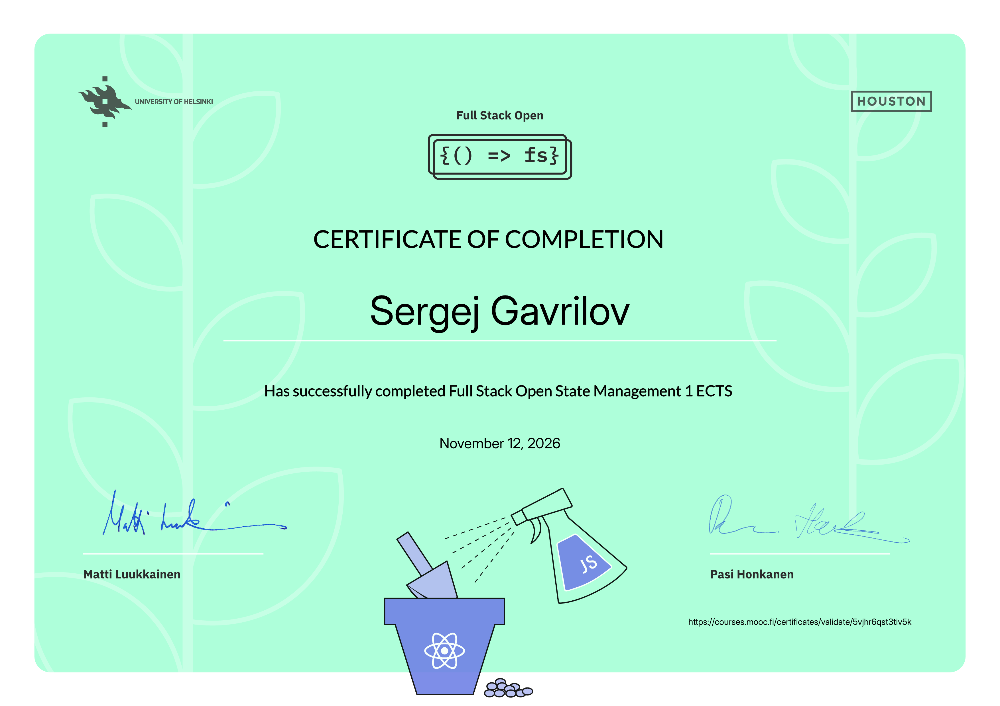

# Full Stack Open — Part 6

Solutions for [Full Stack Open, part 6: Advanced state management](https://fullstackopen.com/en/part6).

Parts 0–5: [fullstack-open-part00-05](https://github.com/Kopfdreher/fullstack-open-part00-05).

Client state uses [Zustand](https://zustand.docs.pmnd.rs/). Server state uses [TanStack Query](https://tanstack.com/query).

| Directory | What it covers |
| --- | --- |
| `counter-zustand` | Zustand counter |
| `counter-contextAPI` | Same counter with React Context |
| `unicafe` | Unicafe in a Zustand store |
| `anecdotes` | Voting, filtering, notifications, backend sync |
| `notes-frontend-zustand` | Notes app with Zustand |
| `notes-frontend-tanStack` | Notes app with TanStack Query |
| `query-anecdotes` | Anecdotes with TanStack Query |

From each app directory: `npm install` and `npm run dev`. Apps that use json-server also need that server running.

## Certificate

